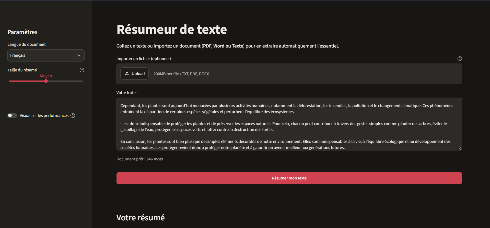
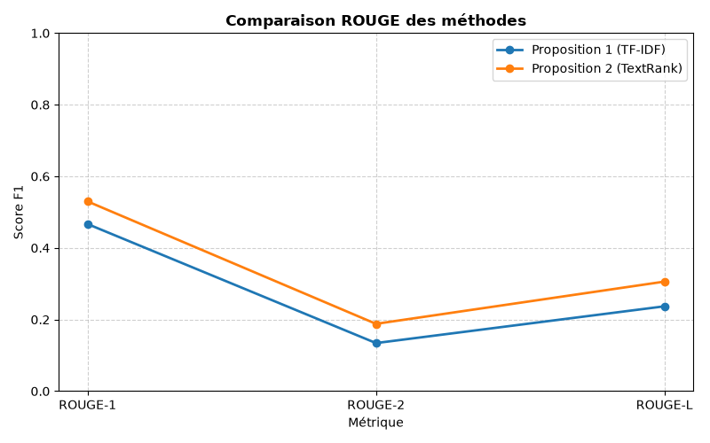
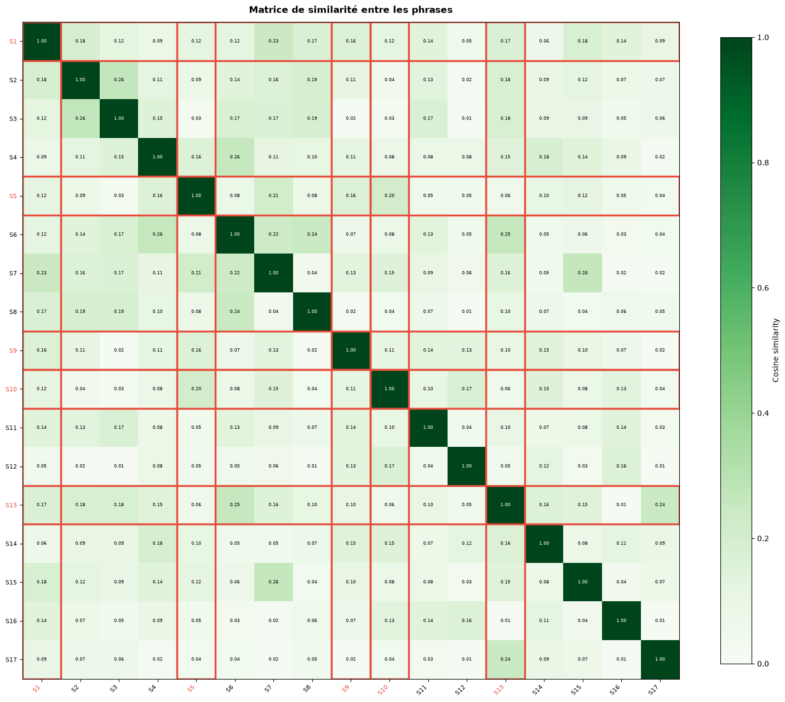
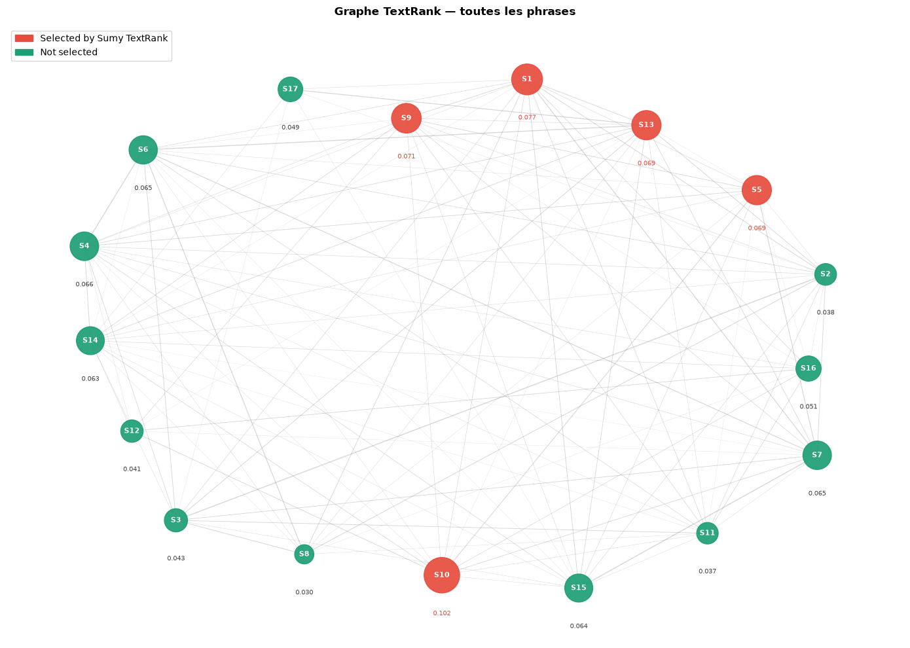
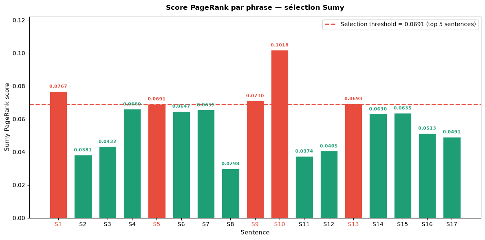
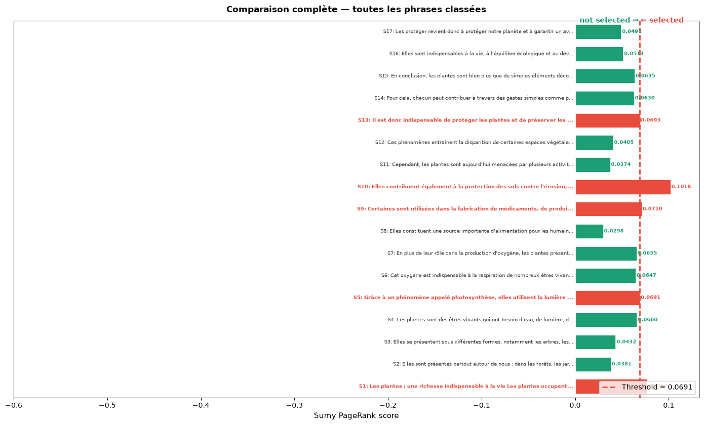

# TextSummarizer-NLP — Résumé Automatique Extractif (TF-IDF vs TextRank)

Application de **Traitement Automatique du Langage Naturel (NLP)** dédiée au **résumé automatique extractif** de documents multilingues (Français et Anglais). Le projet compare deux approches algorithmiques fondamentales — **TF-IDF** et **TextRank (PageRank)** — et évalue scientifiquement la pertinence de leurs synthèses à l'aide des métriques **ROUGE**.

---



---

## Objectif du Projet

Face à l'explosion du volume d'informations textuelles (articles scientifiques, rapports, cours, presse), la lecture intégrale devient chronophage. L'objectif de ce projet est de :

1. **Automatiser l'extraction d'informations clés :** Condenser un document brut (`.txt`, `.pdf`, `.docx`) en conservant uniquement les phrases les plus représentatives sans altérer le sens original.
2. **Comparer deux paradigmes du NLP extractif :** Opposer une approche purement **statistique** (pondération lexicale TF-IDF) à une approche **structurelle basée sur les graphes** (TextRank).
3. **Évaluer objectivement la qualité des résumés :** Mesurer la fidélité des résumés générés face à des résumés de référence rédigés par des humains via les scores **ROUGE-1, ROUGE-2 et ROUGE-L**.
4. **Rendre l'analyse accessible et explicable :** Fournir à la fois une interface utilisateur grand public fluide (Streamlit) et des visualisations détaillant le fonctionnement interne des algorithmes.

---

## Étude Comparative : TF-IDF vs TextRank

Les deux méthodes implémentées relèvent du **résumé extractif** (sélection et réorganisation chronologique des meilleures phrases existantes), mais reposent sur des mécanismes mathématiques distincts :

| Critères | Approche 1 : TF-IDF (*Term Frequency - Inverse Document Frequency*) | Approche 2 : TextRank (Algorithme de graphe via *Sumy*) |
| :--- | :--- | :--- |
| **Paradigme** | Statistique et lexical (sac de mots pondéré). | Théorie des graphes et similarité sémantique (inspiré de PageRank). |
| **Principe de fonctionnement** | Attribue un poids à chaque terme selon sa fréquence dans le document et sa rareté dans le corpus de référence, puis calcule un score pour chaque phrase à partir des poids de ses termes. | Modélise chaque phrase comme un nœud d'un graphe pondéré par la similarité cosinus entre phrases, puis calcule leur centralité. |
| **Points forts** | Très rapide ; excelle pour repérer les phrases contenant des termes techniques, noms propres ou mots-clés très spécifiques. | Prend en compte le contexte global et les relations entre phrases ; produit des synthèses généralement plus cohérentes et représentatives du thème central. |
| **Limites** | Peut survaloriser des phrases courtes contenant un mot rare isolé ; sensible aux variations morphologiques sans racinisation (*stemming*). | Plus coûteux en calcul sur de très longs documents ($O(N^2)$ pour la matrice de similarité) ; tendance à favoriser les phrases longues riches en mots communs. |
| **Usage recommandé** | Extraction rapide de faits précis ou de vocabulaire spécialisé (**Alternative**). | Synthèse globale fluide et équilibrée d'un article (**Synthèse recommandée**). |

---

## Visualisations et Explicabilité

Afin d'éviter l'effet « boîte noire », le pipeline génère automatiquement des graphiques explicatifs sauvegardés dans `outputs/figures/` :

### 1. Évaluation comparative des performances (Métriques ROUGE)
Comparaison des scores **F1** entre TF-IDF et TextRank sur les unigrammes (*ROUGE-1*), bigrammes (*ROUGE-2*) et la plus longue séquence commune (*ROUGE-L*) :



### 2. Fonctionnement interne de TextRank
* **Matrice de similarité cosinus :** Visualise la proximité sémantique entre chaque paire de phrases $(S_1, S_2, \dots, S_n)$ et met en évidence les phrases retenues (encadrées en rouge).
* **Graphe TextRank & Scores PageRank :** Illustre le réseau de relations entre phrases et le seuil de sélection appliqué.

| Matrice de similarité entre phrases | Graphe de centralité TextRank |
| :---: | :---: |
|  |  |

| Distribution des scores PageRank | Classement complet des phrases |
| :---: | :---: |
|  |  |

---

## Résultats Expérimentaux & Limites

### 1. Aperçu des performances (sur `article_1.txt` — 5 phrases extraites)

| Méthode | Métrique | Précision | Rappel | Score F1 |
| :--- | :--- | :---: | :---: | :---: |
| **Proposition 1 (TF-IDF)** | ROUGE-1 | 0.4257 | 0.5164 | 0.4667 |
| **Proposition 1 (TF-IDF)** | ROUGE-2 | 0.1224 | 0.1488 | 0.1343 |
| **Proposition 1 (TF-IDF)** | ROUGE-L | 0.2162 | 0.2623 | 0.2370 |
| **Proposition 2 (TextRank)** | ROUGE-1 | 0.4863 | 0.5820 | 0.5299 |
| **Proposition 2 (TextRank)** | ROUGE-2 | 0.1724 | 0.2066 | 0.1880 |
| **Proposition 2 (TextRank)** | ROUGE-L | 0.2808 | 0.3361 | 0.3060 |

> **Analyse des scores :** **TextRank** obtient un score F1 moyen de **0.3413** contre **0.2793** pour **TF-IDF** (+0.0620), confirmant sa meilleure capacité à capturer la structure globale et les phrases centrales de l'article.  
> Données complètes : [outputs/results/rouge_results.csv](outputs/results/rouge_results.csv)

### 2. Limites actuelles de l'approche extractive
- **Absence de reformulation :** Les phrases sont extraites telles quelles du texte source ; des connecteurs logiques ou pronoms (« *Il*, *De plus* ») peuvent parfois manquer de contexte si la phrase précédente n'a pas été retenue.
- **Sensibilité aux résumés humains abstractifs :** Si le résumé de référence utilise beaucoup de synonymes, les scores ROUGE (basés sur la correspondance exacte de mots) restent mécaniquement modérés malgré une bonne pertinence sémantique.

---

## Technologies Utilisées

* **Langage principal :** Python 3.13
* **Traitement du Langage Naturel (NLP) & Évaluation :**
  * **NLTK :** Tokenisation en phrases (`punkt`), nettoyage et filtrage des mots vides (*stopwords*) multilingues.
  * **Sumy :** Implémentation de l'algorithme **TextRank** avec racinisation (*Stemming*).
  * **Scikit-learn :** Vectorisation TF-IDF et calcul de la similarité cosinus entre phrases.
  * **rouge-score :** Évaluation des résumés générés (Précision, Rappel, F1-score sur ROUGE-1, ROUGE-2 et ROUGE-L).
* **Manipulation de données & Visualisation :**
  * **Pandas & NumPy :** Structuration des résultats et calculs matriciels.
  * **Matplotlib & NetworkX :** Génération des matrices de similarité, graphes de centralité et courbes comparatives.
* **Interface Web & Extraction de documents :**
  * **Streamlit :** Développement de l'application web interactive (avec mise en cache `@st.cache_data` et gestion d'état).
  * **PyMuPDF (`fitz`) & python-docx :** Extraction automatique du texte depuis des fichiers `.pdf` et `.docx`.

---
## Architecture du Projet

```text
TextSummarizer-NLP/
├── app/
│   └── streamlit_app.py        # Interface web interactive (grand public + mode analyse)
├── data/
│   ├── raw/                    # Articles sources bruts (article_1.txt à article_3.txt)
│   └── references/             # Résumés humains de référence (vérité terrain ROUGE)
├── outputs/
│   ├── figures/                # Graphiques générés (ROUGE, matrice, graphe TextRank)
│   ├── results/                # Tableaux CSV et interprétations textuelles des scores
│   └── summaries/              # Résumés générés au format .txt
├── src/
│   ├── __init__.py
│   ├── preprocessing.py        # Nettoyage NLP, tokenisation et suppression des stopwords
│   ├── tfidf_summarizer.py     # Implémentation mathématique de TF-IDF
│   ├── textrank_summarizer.py  # Implémentation TextRank (Sumy) et génération des figures
│   ├── rouge_evaluator.py      # Calcul des scores ROUGE-1, ROUGE-2 et ROUGE-L
│   └── main.py                 # Orchestration du pipeline complet hors-ligne
├── .gitignore
├── download_nltk_data.py       # Script d'installation des ressources linguistiques NLTK
├── README.md
├── requirements.txt            # Dépendances Python du projet
└── run.py                      # Point d'entrée racine pour exécuter le pipeline
```

---

## Installation et Lancement

### 1. Cloner le dépôt et créer l'environnement virtuel
```bash
git clone https://github.com/AdoumOMT/TextSummarizer-NLP.git
cd TextSummarizer-NLP

python -m venv venv
# Sous Windows (PowerShell) :
.\venv\Scripts\Activate.ps1
# Sous Linux / macOS :
source venv/bin/activate
```

### 2. Installer les dépendances et les dictionnaires NLTK
```bash
pip install -r requirements.txt
python download_nltk_data.py
```

### 3. Lancer l'application Web (Interface Streamlit)
```bash
streamlit run app/streamlit_app.py
```
L'interface s'ouvrira automatiquement sur `http://localhost:8501`. Elle permet de coller un texte ou d'importer un fichier (`.txt`, `.pdf`, `.docx`), de choisir la taille du résumé et d'activer à la demande l'affichage des métriques et graphiques de performance.

### 4. Exécuter le pipeline en ligne de commande (Optionnel)
Pour exécuter l'analyse complète sur le jeu de données par défaut (`article_1.txt`) et exporter tous les fichiers dans `outputs/` :
```bash
python run.py
```

---

## Perspectives d'Évolution

Plusieurs axes d'amélioration sont envisagés pour enrichir l'outil :

* **Résumé direct depuis une URL (Web Scraping) :** Ajout d'un champ permettant à l'utilisateur de coller le lien d'un article web ou d'une page Wikipédia. L'application extraira automatiquement le corps principal du texte (via `BeautifulSoup4` ou `trafilatura` en filtrant les menus et publicités) avant d'en générer le résumé.
* **Intégration de modèles abstractifs (Transformers / LLM) :** Ajouter une troisième approche basée sur le Deep Learning (ex. `BART`, `T5` ou `mT5` via Hugging Face) capable de reformuler et synthétiser des phrases inédites, afin de comparer les approches extractives classiques aux modèles génératifs.
* **Filtrage anti-redondance (MMR — *Maximal Marginal Relevance*) :** Pénaliser la sélection de phrases trop similaires entre elles afin de maximiser la diversité des idées couvertes dans le résumé final.
* **Ratio de compression dynamique :** Permettre à l'utilisateur de définir la longueur souhaitée en **pourcentage du document initial** (ex. `20%`) plutôt qu'un nombre fixe de phrases, afin de s'adapter automatiquement aux documents très courts comme aux rapports de plusieurs dizaines de pages.
* **Export multi-formats :** Proposer le téléchargement du résumé final et de son rapport d'analyse directement au format **PDF** ou **Word (`.docx`)** mis en page.
---

## Auteur

**Adoum Oumar Moussa Tahir**  
Étudiant en informatique — Data & IA, Systèmes d'optimisation.

- **GitHub** : [@AdoumOMT](https://github.com/AdoumOMT)

Les retours, suggestions d'amélioration et conseils d'architecture sont les bienvenus !